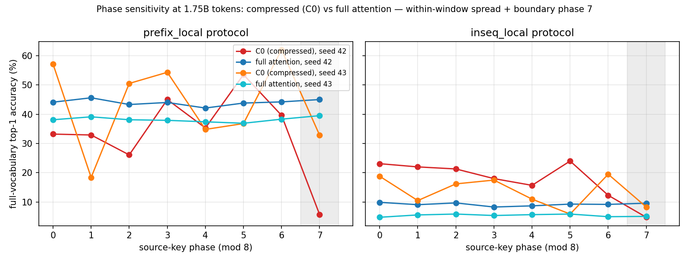

# phase-sensitive-kv

An independent, from-scratch reproduction of **"Periodic Weak Spots: Phase Sensitivity from Chunked KV-Cache Compression"** (ByteDance Seed, [arXiv:2609.36322](https://arxiv.org/abs/2609.36322)).

> **This is an independent reproduction, not the official implementation.**
> The paper's authors did not release code at the time of this work; all code here
> was written from the paper's description and may differ from the original in
> unstated details. Please cite the original paper for the discovery of phase
> sensitivity (BibTeX at the bottom of this page).

Chunked KV-cache compression gives every token a second positional coordinate — its **phase** (position modulo the compression stride). The paper shows that retrieval accuracy in models trained with such compression varies sharply and periodically with the source phase, and that average benchmarks conceal these periodic weak spots. This repo rebuilds the paper's controlled experimental setup on a Qwen3-0.6B backbone with a **data-matched uncompressed (full-attention) control**, and publishes the compressed-reference (`C0`) vs full-attention comparison at 500M, 1.75B and 3.5B training tokens.

## Status

| Component | State |
|---|---|
| Compression kernel (paper reference: W=S=8, 1 KV head, scalar gates, separate K/V) | ✅ implemented |
| Full-attention control (`--layout_kind full`, same backbone/data/optimizer) | ✅ implemented |
| Consistency tests: causality, window/mask indexing, parallel==incremental, KV budget, full-attention path | ✅ passing |
| Phase-sweep evaluator (Prefix / In-sequence, plus *_local phase-randomized variants) | ✅ frozen & verified |
| Pretraining pipeline (torchrun DDP, FineWeb-Edu) | ✅ validated |
| C0 + full attention, 500M tokens (seed 42 pair) | ✅ trained — phase sensitivity vs flat control reproduced |
| C0 + full attention, 1.75B tokens (seeds 42, 43) | ✅ trained — gap contrast categorical across seeds |
| C0, 3.5B tokens (seed 42) | ✅ trained — **gap 46.6 pp** (from 5.0 pp @500M, 27.4 pp @1.75B) |
| Full attention, 3.5B tokens (seed 42) | ✅ trained — **gap 2.5 pp** (flat; three-point control curve closed) |

See [RESULTS.md](RESULTS.md) for the numbers. All trained checkpoints are published in a single
Hugging Face project repo, [wsedoc/phase-sensitive-kv](https://huggingface.co/wsedoc/phase-sensitive-kv):
`c0-1p75b/` and `fullattn-1p75b/` (seeds 42/43), `c0-3p5b/` and `fullattn-3p5b/` (seed 42).

## Key finding

At matched training budgets, **the uncompressed control is flat and the compressed model is not**:

### Core result: phase gap vs budget (C0, prefix_local protocol, seed 42)

| Training tokens | mean acc | worst phase | **phase gap** | boundary (phase 7) |
|---:|---:|---:|---:|---:|
| 500M | 8.7 % | 6.7 % | **5.0 pp** | 3.1 % |
| 1.75B | 33.9 % | 26.1 % | **27.4 pp** | 5.7 % |
| **3.5B** | **57.2 %** | 34.0 % | **46.6 pp** | 9.9 % |
| *Full attention (1.75B)* | *44.0 %* | *42.1 %* | *3.5 pp* | *45.0 %* |
| *Full attention (3.5B)* | *48.8 %* | *47.6 %* | *2.5 pp* | *47.6 %* |

The phase gap grows nearly linearly with budget (5.0 → 27.4 → 46.6 pp) while the uncompressed control stays flat at every matched budget (≤ 4.6 pp across every seed/protocol at 1.75B; 2.2–2.7 pp across all four protocols at 3.5B, no boundary effect) — **phase sensitivity is a compression artifact that intensifies as retrieval capability matures**, approaching the paper's 100B-token magnitude (75.3 pp) at 1/30th of their compute. The boundary phase (7) remains the weakest phase at every budget.

Additional findings:

- Validation loss at parity between C0 and the control — the phenomenon is not a capability artifact;
- The compressed model's seed variance grows with budget (mean seed-std ≈ 0.7 pp at 500M, n=4; 9.4 pp spread across two seeds at 1.75B), while the control stays comparatively stable;
- Uniform-averaging gates (the paper's ablation) remain at chance level at 500M — learned gates are necessary for retrieval to form at this budget;
- Same-seed replica noise (cuDNN nondeterminism) alone produces ±2–3 pp worst/gap swings at 500M: single-seed gap claims carry this measurement floor.

| Per-phase accuracy at 1.75B (both seeds, C0 vs full) |
|---|
|  |

## Repository layout

```
rescsa/
  model/       compressed-attention kernel + full-attention control + Qwen3-subclassed modeling
  data/        FineWeb-Edu tokenization & packing
  eval/        pool curation, frozen phase-sweep evalset generation, evaluator, summaries
  train/       DDP pretraining loop, throughput benchmark
  tests/       consistency, audit-regression, launcher and runtime test suites
results/       final-checkpoint phase evaluations + training logs (C0 & full only)
figures/       generated figures (kernel schematics; result plots)
scripts/       figure generation
```

## Quickstart

Environment: PyTorch 2.10 + transformers 5.x, one or more GPUs (tested on H100 80GB).

```bash
# 1. consistency tests (no data needed)
python -m rescsa.tests.test_consistency
python -m rescsa.tests.test_full_attention

# 2. data: download FineWeb-Edu sample-10BT parquet + Qwen3-0.6B tokenizer files,
#    then pack into fixed-length rows (expects ~10B tokens, ~40 GB disk)
python -m rescsa.data.prepare_data --data_dir <fineweb_dir> --out_dir <out_dir>

# 3. curate single-token pools, then generate & freeze the phase-sweep eval sets
python -m rescsa.eval.curate_pools
python -m rescsa.eval.gen_evalset --out_dir <eval_dir>

# 4. train (2 GPUs; ~64k tokens/s on 2×H100 per compressed run)
CUDA_VISIBLE_DEVICES=0,1 torchrun --standalone --nproc_per_node 2 -m rescsa.train.train \
  --variant C0 --layout_kind fixed --run_name c0_500M --total_tokens 500000000 \
  --data_dir <data_dir> --runs_dir <runs_dir>
# full-attention control: --layout_kind full (same backbone/optimizer/data)

# 5. evaluate a checkpoint against the frozen eval sets
python -m rescsa.eval.run_eval --ckpt <runs>/c0_500M/ckpt_499M.pt --eval_dir <eval_dir> --out eval.json
```

Paths default to the original training node's layout (`/root/rescsa/{data,runs}`);
override with the `--data_dir` / `--runs_dir` / `--eval_dir` flags shown above
(`RESCSA_DATA_DIR` is also honored by the evalset generator).

## Evaluation protocol

Follows the paper's Appendix C, adapted to a single stride (S=8 → 8 residues):

- 64 single-token animal→name pairs, target at body index 24, 8 in-body demonstrations;
- **Prefix Padding**: one filler sentence of exact length Lpre before the body, one of 48−Lpre after; Lpre drawn from a residue-conditioned law with residue-independent moments, so total length, query position, and the target's position distribution are matched across phases;
- **In-sequence Padding**: fixed 8-token guards + 63 bounded gaps of single-token `｜` spacers — changes phase without moving all records together;
- the `*_local` variants additionally randomize neighbour phases at every record gap (uniform 0–7 spacers), decoupling the target's phase from local record density; a remote gap absorbs the phase shift and trailing padding holds the length fixed;
- every prompt is verified to re-tokenize to its constructed ids (including with the gold token appended);
- metrics: per-phase full-vocabulary top-1 (primary), candidate-restricted top-1, gold probability/NLL; phase 7 (boundary) reported separately from phases 0–6; paired bootstrap over logical examples for CIs.

## Deviations from the paper

The paper trains 100B tokens with a global batch of ~2.1M tokens; this reproduction uses 500M and 1.75B tokens at 131k tokens/step (peak LR 1.2e-3 instead of 2e-3, warmup 2%, cosine to 2e-5; other optimizer settings identical). The corpus is FineWeb-Edu (sample-10BT). Gate maps are zero-initialized so the learned kernel starts as the exact uniform average. These choices trade closeness-to-paper for feasibility at small budgets; all comparisons in [RESULTS.md](RESULTS.md) are internally controlled and data-matched. The paper's mechanism-level analyses (KV-head knockouts, gate cycling) are not re-run here.

## Acknowledgments

This reproduction stands on the paper by Zhu, Yi, Cheng, et al. (ByteDance Seed). The Qwen3-0.6B architecture and tokenizer are used via Hugging Face `transformers`.

## Citation

If you use this repo, please cite the original paper:

```bibtex
@article{zhu2026periodic,
  title   = {Periodic Weak Spots: Phase Sensitivity from Chunked KV-Cache Compression},
  author  = {Zhu, Xingyu and Yi, Pu (Luke) and Cheng, Ziheng and Lv, Ang and Liu, Jing and Ying, Lexing and Ma, Yiyuan and Dong, Xin},
  journal = {arXiv preprint arXiv:2609.36322},
  year    = {2026}
}
