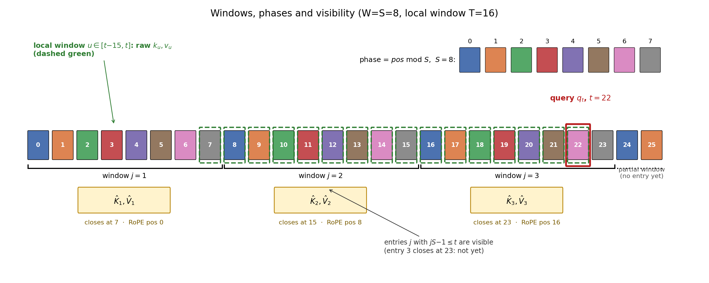
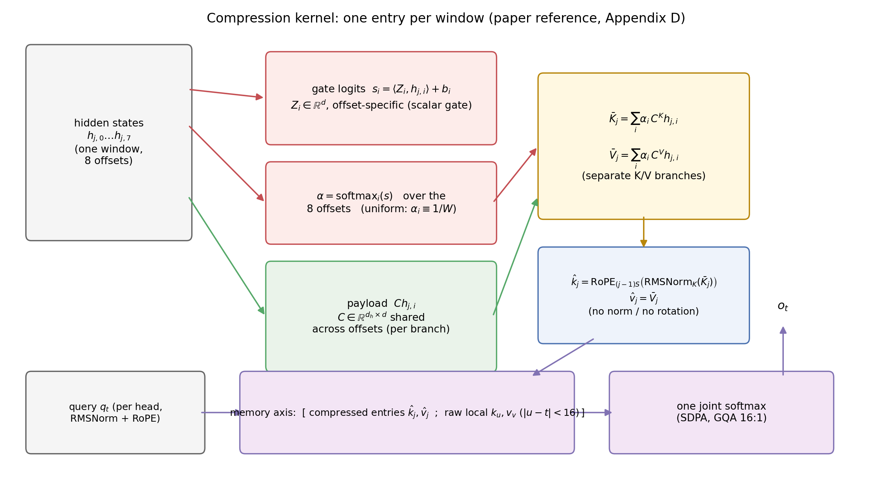
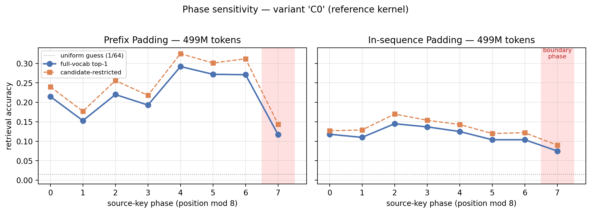
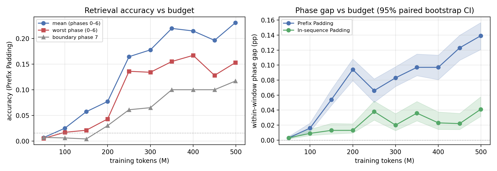

# phase-sensitive-kv

An independent, from-scratch reproduction of **"Periodic Weak Spots: Phase Sensitivity from Chunked KV-Cache Compression"** (ByteDance Seed, [arXiv:2609.36322](https://arxiv.org/abs/2609.36322)).

> **This is an independent reproduction, not the official implementation.**
> The paper's authors did not release code at the time of this work; all code here
> was written from the paper's description and may differ from the original in
> unstated details. Please cite the original paper for the discovery of phase
> sensitivity (BibTeX at the bottom of this page).

Chunked KV-cache compression gives every token a second positional coordinate — its **phase** (position modulo the compression stride). The paper shows that retrieval accuracy in models trained with such compression varies sharply and periodically with the source phase, and that average benchmarks conceal these periodic weak spots. This repo rebuilds the paper's controlled experimental setup on a Qwen3-0.6B backbone and confirms the phenomenon at a small (500M-token) training budget.

## Status

| Component | State |
|---|---|
| Compression kernel (paper reference: W=S=8, 1 KV head, scalar gates, separate K/V) | ✅ implemented |
| Uniform-averaging variant (paper ablation) | ✅ implemented |
| Consistency tests: causality, window/mask indexing, parallel==incremental, KV budget | ✅ 7/7 passing |
| Phase-sweep evaluator (Prefix / In-sequence padding protocols) | ✅ frozen & verified |
| Pretraining pipeline (torchrun DDP, FineWeb-Edu) | ✅ validated |
| Reference model, 500M tokens | ✅ trained — **phase sensitivity reproduced** |

See [RESULTS.md](RESULTS.md) for the numbers. The trained 500M-token reference
checkpoint will be published on Hugging Face (link added once the upload completes).

## Figures

**Kernel structure** (generated by `scripts/plot_kernel_diagram.py`):

| Windows, phases and visibility | Compression-kernel dataflow |
|---|---|
|  |  |

**Results** (generated by `scripts/plot_results.py --run_dir <run>`):

| Per-phase accuracy (learned / uniform) | Budget scaling (learned) |
|---|---|
|  |  |

## Key finding (at 500M tokens)

Training the reference kernel on 500M tokens of FineWeb-Edu already yields statistically significant phase sensitivity:

- **Within-window phase gap 14.9 pp** (best phase 23% vs worst 8%, paired bootstrap 95% CI [13.3, 16.6]) under Prefix Padding, growing monotonically with budget (7.2 pp @ 200M → 14.9 pp @ 500M);
- **Boundary phase (phase 7) is fully suppressed** (~1% vs 8–23% elsewhere): key–value pairs that straddle a window boundary are essentially unlearned, matching the paper's boundary asymmetry;
- The effect also appears under In-sequence Padding (4.5 pp, CI [3.6, 5.8]), where distractor records do not move in lockstep with the target.

All numbers at a fraction of the paper's 100B-token budget, on 2×H100 in ~2.2 h.

## Repository layout

```
pskv/
  model/       compressed-attention kernel (attention.py) + Qwen3-subclassed modeling
  data/        FineWeb-Edu tokenization & packing
  eval/        pool curation, frozen phase-sweep evalset generation, evaluator, summaries
  train/       DDP pretraining loop, throughput benchmark
  tests/       consistency test suite
results/       per-checkpoint phase evaluations + training logs
figures/       generated figures (kernel schematics; result plots)
scripts/       figure generation
```

## Quickstart

Environment: PyTorch 2.10 + transformers 5.x, one or more GPUs (tested on H100 80GB).

```bash
# 1. consistency tests (no data needed)
python -m pskv.tests.test_consistency

# 2. data: download FineWeb-Edu sample-10BT parquet + Qwen3-0.6B tokenizer files,
#    then pack into fixed-length rows (expects ~10B tokens, ~40 GB disk)
python -m pskv.data.prepare_data --data_dir <fineweb_dir> --out_dir <out_dir>

# 3. curate single-token pools, then generate & freeze the phase-sweep eval sets
python -m pskv.eval.curate_pools
python -m pskv.eval.gen_evalset

# 4. train (2 GPUs; ~64k tokens/s on 2×H100)
CUDA_VISIBLE_DEVICES=0,1 torchrun --nproc_per_node 2 -m pskv.train.train \
  --variant learned --run_name learned_500M --total_tokens 500000000

# 5. evaluate a checkpoint against the frozen eval sets
python -m pskv.eval.run_eval --ckpt <runs>/learned_500M/ckpt_499M.pt --out eval.json
python -m pskv.eval.summarize <runs>/learned_500M
```

Paths default to the original node layout (`/root/rescsa/{data,runs}`); override with `PSKV_DATA_DIR` / `PSKV_RUNS_DIR`.

## Evaluation protocol

Follows the paper's Appendix C, adapted to a single stride (S=8 → 8 residues):

- 64 single-token animal→name pairs, target at body index 24, 8 in-body demonstrations;
- **Prefix Padding**: one filler sentence of exact length Lpre before the body, one of 48−Lpre after; Lpre drawn from a residue-conditioned law with residue-independent moments (X = M + U1+U2+U3+F), so total length, query position, and the target's position distribution are matched across phases;
- **In-sequence Padding**: fixed 8-token guards + 63 bounded gaps (0–4 single-token `｜` spacers, 126 total) with the pre-target gaps summing to Lpre−8 — changes phase without moving all records together;
- every prompt is verified to re-tokenize to its constructed ids (including with the gold token appended);
- metrics: per-phase full-vocabulary top-1 (primary), candidate-restricted top-1, gold probability/NLL; phase 7 (boundary) reported separately from phases 0–6; paired bootstrap over logical examples for CIs.

## Deviations from the paper

The paper trains 100B tokens with a global batch of ~2.1M tokens; this reproduction uses 500M tokens at 131k tokens/step (peak LR 1.2e-3 instead of 2e-3, warmup 2%, cosine to 2e-5; other optimizer settings identical). The corpus is FineWeb-Edu (sample-10BT). Gate maps are zero-initialized so the learned kernel starts as the exact uniform average. These choices trade closeness-to-paper for feasibility at small budgets; all comparisons in [RESULTS.md](RESULTS.md) are internally controlled.

## Acknowledgments

This reproduction stands on the paper by Zhu, Yi, Cheng, et al. (ByteDance Seed). The Qwen3-0.6B architecture and tokenizer are used via Hugging Face `transformers`.

## Citation

If you use this repo, please cite the original paper:

```bibtex
@article{zhu2026periodic,
  title   = {Periodic Weak Spots: Phase Sensitivity from Chunked KV-Cache Compression},
  author  = {Zhu, Xingyu and Yi, Pu (Luke) and Cheng, Ziheng and Lv, Ang and Liu, Jing and Ying, Lexing and Ma, Yiyuan and Dong, Xin},
  journal = {arXiv preprint arXiv:2609.36322},
  year    = {2026}
}
```

## License

MIT — see [LICENSE](LICENSE).
